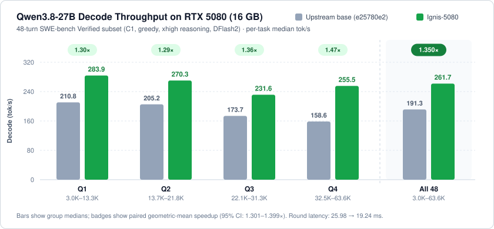

# Ignis-5080

An RTX 5080-focused fork of [Ignis](https://github.com/gpillon/ignis) for serving **Qwen3.8-27B** on a single **RTX 5080 16 GB** (`sm_120a`), built for low-latency local chat and coding agents. Across a 48-turn SWE-bench Verified subset, it achieves the **fastest open-source Qwen3.8-27B decode measured on an RTX 5080** (**261.71 tok/s** median, **280.33 tok/s** pooled; **+35.0%** over the upstream fork baseline).

It supports text, reasoning, tool calls, and image input through OpenAI-compatible Chat Completions and Responses APIs, with SSE/WebSocket streaming, an integrated Chat/Monitor UI (`/ui/`), Prometheus metrics, KV-RAM/KV-disk tiers, and idle unload/reload.

### Scope & defaults

- **Target hardware & model**: Linux with one RTX 5080 16 GB (`sm_120a`) running Qwen3.8-27B Trellis + DFlash2 speculative decoding. Speech, image generation, multi-model catalog entries, public tunnels, and Windows production builds are removed ([ADR 0079](docs/adr/0079-the-fork-serves-qwen38-27b-on-one-rtx-5080.md)).
- **Production defaults (`rtx50-16gb`)**: two decode lanes, DFlash2 with 7 draft tokens, **NVFP4 KV cache** (139,264 default context vs. upstream HQ KV's 262,144; HQ KV remains supported), a repacked 31-tensor DFlash2 artifact (stock artifact supported as fallback), host-mapped token embeddings, and PCIe-staged Vision weights.

---

## Decode Performance

Evaluated on a **48-turn SWE-bench Verified subset** across 12 repositories (2,978–63,564 input tokens, C1, greedy, `xhigh` reasoning, no cross-request prefix reuse, server-side decode timing):

- **261.71 tok/s** per-task median decode (**280.33 tok/s** pooled `output tokens / decode seconds`)
- **1.350× (+35.0%)** paired geometric-mean speedup over the upstream fork baseline (`e25780e2`, 95% stratified bootstrap CI `1.301–1.399×`, faster on 47/48 tasks, **1.466×** on the longest 32.5K–63.6K quartile)
- **25.98 ms → 19.24 ms** mean speculative round latency (-25.9%, ~5.39 emitted tokens/round)
- **49.6% → 68.1%** estimated logical model bandwidth utilization (**476 → 654 GB/s** against the RTX 5080's 960 GB/s nominal GDDR7 bandwidth)



### Comparison & reference points

| Engine / configuration | GPU | Decode (tok/s) | Workload & source |
|---|---|---:|---|
| **Ignis-5080 (`8495f3a0`)** | 1× RTX 5080 16 GB | **261.71** (280.33 pooled) | Same GPU, 48-turn SWE-bench Verified subset (3K–64K, greedy, xhigh thinking), median |
| Upstream Ignis (`e25780e2`) | 1× RTX 5080 16 GB | 191.34 (203.24 pooled) | Same GPU, same 48-turn subset (fork baseline, HQ KV), median |
| Ferrite 0.9.2 | 1× RTX 5080 16 GB | 183.21 (199.36 pooled) | Same GPU, same 48-turn subset (verified identical prompt tokens, MTP + copy), median |
| FLYX (UD-IQ3_XXS + MTP) | 1× RTX 5080 16 GB | 225.9 / 161.0 / 105.8 | Published: 1K / 128K / 256K input, thinking off, 512-tok generation ([report](https://github.com/enwove/flyx/blob/main/docs/benchmarks.md)) |
| NInfer-5080 v1.5 | 1× RTX 5080 16 GB | 112.2 | Published: release sustained decode, 131K configured context ([repo](https://github.com/toddballinger/ninfer-5080)) |
| SGLang + Escha-W2 (MTP) | 1× RTX 5080 16 GB | 109.2 | Published: 2-bit weights, single user ([model card](https://huggingface.co/EschaLabs/Qwen3.8-27B-Escha-W2)) |
| llama.cpp (UD-IQ3_S + MTP3) | 1× RTX 5080 16 GB | 95.7–96.0 | Community: 30K warm prompt (106.8–109.0 short) ([configs](https://github.com/BFinn/5080-llm-configs/tree/main/models/qwen3.8-27b)) |
| ExLlamaV3 1.6 + DFlash2 | 1× RTX 5090 32 GB | 274.6 | Community: RigMark coding, EXL3 4.0 bpw, thinking off ([benchmark](https://github.com/MiaAI-Lab/Qwen3.8-27B-16gb-NVIDIA-GPUs-one-click-install#what-was-measured)) |
| vLLM 0.28 + MTP | 1× RTX 5090 32 GB | 175.0 | Community: NVFP4 KV single-stream code decode ([matrix](https://github.com/adrienbrault/qwen3.8-27b-rtx5090)) |

Full methodology, paired ratios, and limitations: [benchmark summary (zh-CN)](docs/rtx-5080-decode-benchmarks.zh-CN.md) · [upstream A/B](docs/findings/2026-11-23-coding-agent-48-decode.md) · [open-source comparison](docs/findings/2026-11-24-ferrite-coding-agent-48.md).

### Where the round-time reduction comes from

The 6.74 ms/round reduction (`25.98 → 19.24 ms`) comes from systematic profiling and kernel work across every stage of a Qwen3.8-27B speculative decode round on `sm_120a`:

- **Trellis MLP & projections**: static CTA mapping with `4×32` output tiling to eliminate persistent-scheduler conflicts with Blackwell PDL, pipelined 3-bit `T=8` MLP decode, and dedicated 2/3-bit `T=8` down-projection reduction ([MLP scheduling & PDL](docs/findings/2026-11-11-rtx5080-t8-mlp-scheduling.md), [static decode & down reduction](docs/findings/2026-11-16-trellis-static-decode-and-down-reduction.md)).
- **GQA & NVFP4 KV**: paged NVFP4 (`E2M1` + per-16 `E4M3` scale) KV cache with a FlashInfer-derived `M48/K32/V32` BF16-MMA decoder, a `32 sink + 512 recent + fresh` BF16 precision window with cost-weighted split balancing inside CUDA Graphs, and fused single-lane verify ([NVFP4 KV & attention](docs/findings/2026-11-20-nvfp4-kv-attention.md)).
- **GDN sublayers**: joint QKV/Z projections with paired input rotations, fused 128-d gated RMSNorm + rotation + residual add, and CUDA-event side-stream overlap of BF16 gating with QKV/Z + conv ([GDN fusion](docs/findings/2026-11-21-gdn-joint-projection-and-gated-rotation.md), [gating overlap](docs/findings/2026-11-23-gdn-gating-overlap.md)).
- **DFlash2 drafter**: all 31 NVFP4 drafter weights repacked to small-`T` `MMA16` layout, omitting unused Q rows during commit and removing redundant D2D copies and speculative hidden-state staging ([DFlash2 MMA16 layout](docs/findings/2026-11-22-dflash2-remaining-nvfp4-mma16.md)).

See [docs/findings/README.md](docs/findings/README.md) for the complete experiment log, including profiling breakdowns, numerical error audits, and rejected candidates.

---

## Quick Start

**Requirements**: Linux host with one RTX 5080 16 GB, CUDA 13 toolkit (`sm_120a`), Rust toolchain, Python 3, and Node.js (optional, for the web UI).

### 1. Prepare the model artifact

Download the pinned 27B Trellis artifact (`qwen3_8_27b_trellis_sc30-v2.ninfer`) with its verification sidecar into `models/` (or run `ignis-server model download qwen3.8-27b-16g` after building).

For the production RTX 5080 DFlash2 layout, repack all 31 drafter NVFP4 projections once (~13.4 GB extra disk space during conversion):

```sh
python3 scripts/repack_dflash2_gate_up.py \
  models/qwen3_8_27b_trellis_sc30-v2.ninfer \
  models/qwen3_8_27b_trellis_sc30-dflash-projections.ninfer \
  --projection mlp/gate_up --projection mlp/down --projection attention/output \
  --projection attention/query_key_value --projection feature_projection \
  --projection attention/conv_proj --projection mlp/conv_proj
```

`make` automatically picks up the repacked artifact when present and falls back to the catalog artifact otherwise.

### 2. Build and start

On the Linux RTX 5080 host (or via `python3 scripts/remote.py exec -- ...` from a laptop):

```sh
make build CUDA=1 UI=1
make gpu-status
make start CUDA=1 UI=1
make status
```

Stop the service when finished with `make stop`.

### 3. Send a request

The server listens on `http://127.0.0.1:8000` by default (Chat/Monitor UI at `/ui/`, health at `/health` and `/ready`, Prometheus metrics on `:9464`):

```sh
curl http://127.0.0.1:8000/v1/chat/completions \
  -H "Content-Type: application/json" \
  -d '{
    "model": "qwen3.8-27b-16g",
    "messages": [{"role": "user", "content": "Explain CUDA Programmatic Dependent Launch in 3 sentences."}],
    "stream": true
  }'
```

For full CLI flags, profile tuning, API keys, and remote laptop usage, see [docs/user/README.md](docs/user/README.md).

---

## Architecture & Development

Rust handles HTTP serving, admission, chunked prefill/decode scheduling, prefix reuse, and host/SSD state tiering (`core` / `runtime`); C++/CUDA implements the GPU operators (`sm_120a`) behind a C ABI. Active sequences and activations stay resident in VRAM while embeddings map from host RAM and Vision weights stage over PCIe per encode.

Development uses a laptop-to-Linux workflow (`scripts/remote.py`) paired with **Kernel Lab** — a resident-engine DSO hot-reload and real-input replay harness (inspired by Together's compiler/kernel workflow) for iterating on CUDA operators and layer segments without reloading the 27B weights.

### Documentation

- [Architecture](docs/architecture.md)
- [Run and use the service](docs/user/README.md)
- [Decode benchmark report (zh-CN)](docs/rtx-5080-decode-benchmarks.zh-CN.md) · [48-turn upstream A/B (en)](docs/findings/2026-11-23-coding-agent-48-decode.md) · [Coding-agent benchmark protocol](docs/user/contributing/coding-agent-benchmark.md)
- [Kernel Lab](docs/user/contributing/kernel-lab.md) · [Laptop / remote Linux development](docs/user/contributing/remote-dev.md) · [Testing](docs/agents/testing.md)
- [Scope decision (ADR 0079)](docs/adr/0079-the-fork-serves-qwen38-27b-on-one-rtx-5080.md) · [Terminology](GLOSSARY.md)

### License & Attribution

Licensed under [Apache-2.0](LICENSE). Forked from [gpillon/ignis](https://github.com/gpillon/ignis); third-party and adapted CUDA kernel attributions (including FlashInfer XQA) are recorded in [NOTICE](NOTICE) and [kernel/NOTICE](kernel/NOTICE).
