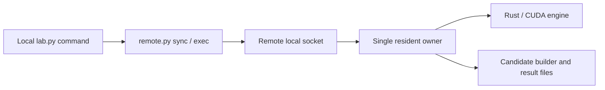

# Single-writer resident kernel experiments

Design revision: 2026-11-12. The target is four independent local commands with
automatic synchronization and one supervised remote resident engine. This
supersedes the foreground interactive/long-lived SSH proposal. The commands
and benchmark capture/replay are not implemented yet; the existing Trellis
reload primitive, builder and finite-batch driver remain available.

The [implementation plan](implementation-plan.md) defines command behavior,
failure handling, data contracts, implementation order and acceptance.

## Goal and assumptions

One agent edits one Laptop worktree; one dedicated remote checkout receives
its source. Keep the existing numerical gates, warmup/sample rules and baseline
controls. Simplify the control/lifecycle around them, without depending on a
faster compiler, fewer samples or a weaker oracle.

The user invokes one command at a time and waits for feedback before editing
again. Busy/conflicting commands are refused, not queued. GPU utilization is
an observation; the objective is a short, trustworthy iteration loop.

## What we take from Together Compiler

The [blog](https://www.together.ai/blog/together-compiler-continual-compilation-for-ai-inference)
uses persistent engines to avoid repeated initialization and measurement tiers
to balance speed and realistic inputs. We apply those mechanisms to one writer,
one fixed model and one GPU. Its multi-agent candidate supply and distributed
configuration search do not become requirements of this design.

## Entry points and architecture

Proposed commands, not currently executable:

```sh
python3 scripts/lab.py setup
python3 scripts/lab.py replay
python3 scripts/lab.py forward
python3 scripts/lab.py stop
```

| Command | Behavior |
|---|---|
| setup | Sync, build/pin baseline runtime, start the remote owner/engine, prepare benchmark inputs, load or generate a compatible replay corpus; return only when fully ready. |
| replay | Check owner/configuration/edit boundary, sync, build/reuse the current candidate, hot-load and compare captured local computations, restore baseline and return results. |
| forward | Use the same preparation and local gate, then execute original benchmark inputs through the full model; restore baseline and return results. |
| stop | Stop the identified owner/engine/process group and release the card, without sync or requiring compilable source. Keep corpus and results. |

The local `lab.py` wrapper calls existing `remote.py sync/exec` internally.
It does not implement another SSH or source-transfer stack. The remote owner
reuses `scripts/kernel_lab.py`'s Session, build/comparison and result logic and
directly supervises the Rust engine. A private remote Unix socket connects
short-lived command clients to that owner. The engine's existing JSONL remains
an internal channel. No public TCP/HTTP interface, candidate inbox, job
database, scheduler or durable task queue is introduced.



Closing an ordinary command/SSH connection does not stop the idle engine.
The owner and baseline binary execute from pinned runtime files outside the
mutable source checkout, so synchronization cannot replace live control code.
The source can change between evaluations; the loaded host and its ABI stay
fixed. Setup owns the GPU lock for the resident lifetime; an accidental second
session fails rather than waiting.

## Experiment purpose and lifecycle

The experiment is a question, baseline, workload/metric, numerical rule,
allowed changes and stopping rule recorded in `.scratch/`. It is not a service
object. A resident session holds one fixed engine/model/configuration. An
evaluation is a synchronous candidate comparison. A candidate is an immutable
library plus source/build identity. A replay corpus persists benchmark call
inputs and reference outputs for compatible future sessions.

Setup verifies the read-only model, pins baseline and configuration, loads the
engine and prepares the corpus. First-time recording has its own cost; later
setup can load existing files. Record identity checks, compilation, model load,
capture and corpus loading separately. Setup after a fault reuses the pinned
baseline rather than silently rebuilding it from edited candidate code.
Selecting a new baseline is explicit: the proposed `setup --new-baseline`
requires the previous session to be stopped. Repeated setup for a matching live owner
reports its state instead of synchronizing or replacing it.

A local command lock covers evaluation preparation, synchronization and
execution. Check remote owner/session identity and busy state before sync;
verify the synchronized source identity before building. Sync failure cannot
fall through to an old candidate. Save the small compiled input set, compiler
flags and binary hash. Unchanged source reuses the existing sync/build caches.
Do not manually synchronize during a lab command or introduce another writer
outside these assumptions.

Each accepted evaluation records its identity, uses the shared numerical and
bracketing-control functions, restores baseline, then publishes its completed
result. Numerical failure still records failure; a local speedup alone does
not establish a full-forward improvement. `forward` runs its local gate before
executing the original model inputs.

Stop uses recorded connection/process identity and a pinned cleanup path; it
must remain usable when the source does not compile, configuration files have
changed or the evaluation is blocked. It can interrupt an evaluation without
waiting for that evaluation's command lock. Verify process birth identity,
not just PID, and never stop unrelated processes.

Compile or admission failures leave baseline available. CUDA failure, timeout
or failed restoration ends the session. The owner must clean up children on
failure; no GPU process may silently outlive ownership. Accepted operations
can finish or time out after a client disconnect and persist their results;
there is no automatic replay. Only active/last-operation metadata and result
files are needed. Repeated setup can report the existing session/result.
This is bounded process supervision, not resumable job scheduling.

The old experiment queue remains a separate tool. Do not launch this mutable
workflow inside a frozen queue job or extend that queue to host these sessions.

## Hot-loading scope

Reuse the tested model-local linear/SwiGLU function table and graph rollback.
Weights, model handles, streams and workspace belong to the host; the plugin
owns code. Replacement requires an empty pool, recaptures decode/verify graphs
and keeps old code alive until its graphs are destroyed.

The initial hot-edit set is `kernel/src/trellis_linear.cu`,
`trellis_linear_decode.cu`, `trellis_linear_prefill.cu`,
`trellis_linear_internal.cuh` and `trellis_decode.cuh` in that directory.
Changes to host/runtime, exported ABI, other operators or load configuration
require a new setup. Notes and non-runtime documents do not force a restart.
Do not silently ignore edits outside the supported set.

This covers every Trellis linear/SwiGLU role: MLP, GQA and GDN projections and
the output head. It does not replace attention, convolution or recurrent-state
updates, and needs no generic KV/GDN snapshot facility. Libraries are trusted
native code; descriptor checks catch accidental incompatibility.

## Two measurement levels

| Level | Input and result |
|---|---|
| Local replay | Actual selected Trellis calls recorded from the three coding-agent benchmark fixtures: inputs, initial ADD target, reference output and call metadata. Run the current plugin against them. |
| Full forward | Original prepared benchmark inputs, with candidate-generated activations, state and tokens through the full model. Report engine timing, termination and speculative behavior. |

Reuse the request/template/tokenizer path and preserve relevant EOS, reasoning,
budget, cold-prefix and DFlash2 controls. C1 means sequential requests even
when the engine has two configured lanes. No HTTP service is required, and
engine timings are not comparable directly with historical service TPS.

Persist a manifest and tensor files; reuse weights by stable tensor/view
identity, not saved GPU addresses. Compatible sessions load the same corpus.
Changed model/baseline/fixture/preparation/configuration/capture-format identity
requires recapture. Publish a corpus only after complete recording/checks;
corruption, insufficient space or incomplete data must not lead to silent
sampling or apparently successful partial coverage.

Record all selected calls initially and measure their storage cost. The corpus
can be complete while setup pins an explicit measurement view (op/layer/shape
or record range); report that coverage and hold it constant across candidates.
Do not silently sample or assume replaying the entire corpus must be faster
than full forward. Bound capture memory and stream data to disk. Capture graph execution, not host
construction calls; do not overwrite earlier call data before saving it.
Recording can use explicit bounded groups if necessary, preserving coverage
and baseline trajectory. Remove recording nodes before timing clean graphs.

Replay uses the current candidate function table. Restore mutable buffers and
workspace outside timing; create local timing graphs after candidate load and
destroy them before replacement. Full forward must not consume recorded
intermediates or be forced along the baseline output trajectory. Local replay
has different cache conditions; its timings cannot be summed into a claimed
whole-model speedup.

Keep current numerical gates, warmups, raw samples and bracketing controls.
Arithmetic changes require an independently justified oracle. The old
fresh-state `layer` probe is replaced as the default fast path, rather than
maintaining two competing local measurement implementations.

## Implementation and acceptance boundary

Reuse the builder, Rust JSONL process, C ABI, workspace checks and graph
replacement. Add the four-command wrapper/local socket supervision, benchmark
adaptation and real-call capture/replay, following P1–P4 of the
[implementation plan](implementation-plan.md). Do not add a new compiler cache,
a general plugin registry, background data management or automatic recovery.

Acceptance covers two successive code edits with one engine load; the same
candidate executing in both tiers; source/owner/busy checks before sync;
errors never measuring stale code; independent stop and subprocess cleanup;
reuse of an intact disk corpus after restart; capture-free timing graphs;
and preservation of baseline identity on failure. Measure control/sync/build/
reload/replay/forward separately. New command latency is not established by
old reload-only timings.

Repository-required implementation tests remain mandatory. HTTP/service
benchmarks and their capacity/canary acceptance are outside this feature.
See the [current usage guide](../../user/contributing/kernel-lab.md) for the
implemented batch tools and the
[measurement finding](../../findings/2026-11-12-resident-kernel-experiments.md)
for evidence about the existing reload primitive.
