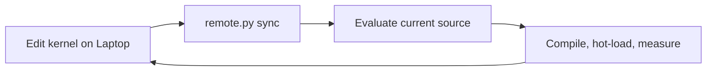

# Single-writer resident kernel experiments

Design revision: 2026-11-12. This replaces the earlier target of a shared
resident engine receiving candidates from multiple agents or queue jobs.
The interactive workflow below is proposed, not implemented. The
[implementation plan](implementation-plan.md) records the audited gaps and
latest benchmark-derived capture/replay scope. The existing
Trellis reload primitive and finite batch driver remain the implementation.

## Goal and assumptions

Keep the current compilation and measurement protocol, while removing the
coordination machinery unnecessary for one optimization thread. Success means
the same trustworthy feedback with fewer components and lifecycle rules. It
does not depend on a faster compiler, fewer samples or weaker numerical gates.

One agent edits one Laptop worktree. One dedicated Linux checkout receives its
changes. One foreground driver owns one resident engine and the RTX 5080.
The agent submits one evaluation at a time and waits for its result before
editing or synchronizing again. GPU utilization is an observation; shortening
the hypothesis-to-result loop is the objective.

## What we take from Together Compiler

The [blog](https://www.together.ai/blog/together-compiler-continual-compilation-for-ai-inference)
uses persistent engines to avoid repeated initialization, and measurement
tiers to balance iteration speed with realistic inputs. It also uses multiple
agents to supply candidates and a cost model for distributed configurations.
Our design inference is that the first two mechanisms remain useful with one
writer. The fixed model and single GPU do not require the latter mechanisms.

## Architecture

Reuse three existing pieces:

- `scripts/remote.py`: synchronization and the foreground SSH entry point.
- `scripts/kernel_lab.py`: compilation/comparison orchestration and one
  controlling stdin/stdout stream; add an interactive loop to this script.
- The Rust `kernel_lab` example: the loaded model, serial JSONL operations and
  the existing model-local Trellis replacement API.

The Python driver directly owns the Rust child. It is not a daemon, task
broker or multi-client service. The SSH connection stays open during editing
and evaluation; the agent retains that foreground process's input/output
handle. No socket service, candidate inbox, polling worker, job database or
new RPC layer is needed.



The same Rust engine stays alive across this loop. Source synchronization
updates the development checkout; it does not rebuild or replace that engine.
A second attempted session fails the host-wide GPU lock immediately. It does
not wait in a queue. Continue to check `make gpu-status` before launching GPU
work and before changing GPU workloads.

## Experiment purpose and lifecycle

An experiment is a bounded question with a baseline, workload/metric,
numerical acceptance rule, allowed changes and stopping rule. Record those in
`.scratch/` and close the question with evidence and a supported, rejected or
inconclusive conclusion. It needs no new runtime object or database entry.

Only two operational units matter in the normal loop:

| Unit | Lifetime |
|---|---|
| Resident session | One driver/engine lifetime with fixed host binary, artifact and load settings. Setup happens once; stopping or recovering ends it. |
| Evaluation | One synchronous build/check/reload/measure/restore operation on one immutable candidate. Its result is recorded before the next evaluation. |

A candidate is a file plus provenance, not a scheduled job. The existing
`remote.py experiment` queue remains a separate tool for delegated or isolated
jobs; it is not a dependency of this workflow. Do not run the mutable
interactive mode inside a frozen queue job: that runner correctly refuses
changes to its submitted checkout.

### Setup

Starting the interactive driver performs setup:

1. Acquire the existing host-wide exclusive GPU lock and verify the card is
   free. Hold the lock until the engine and its children have exited.
2. Pin the baseline engine binary, its source/build identity, artifact identity,
   settings and measurement plan in the session output directory. Verify the
   read-only model once; there is no queue layer repeating its hash checks.
3. Load the model, reserve its state/workspaces, capture graphs and establish
   numerical references for the planned cases. Keep weights and allocations
   resident thereafter.

The baseline binary is immutable for the session and reusable for recovery.
A candidate crash must not cause a restart to rebuild the baseline from the
currently edited candidate source. Rebuilding the host or choosing a new
baseline is an explicit new session, with a new recorded identity.

### Evaluate current source

Expose one ordinary command that includes reload and measurement. The agent
does not need to separately manage candidate admission, activation, timing and
rollback. Proposed input, not an existing CLI feature:

```json
{"op":"evaluate","through":"replay"}
{"op":"evaluate","through":"forward"}
{"op":"stop"}
```

The plan and its case definitions are fixed at setup; `through` selects the
existing measurement levels, not new inputs, tolerances or timing rules.
Unchanged source can reuse its already compiled candidate for a deeper check.

For each evaluation the driver:

1. Checks that runtime-source changes are confined to the documented Trellis
   edit set. A host/ABI/configuration change is refused with the changed paths
   and a request to start a new session; it must not be silently ignored.
2. Saves the small candidate input set (the three translation units and their
   required headers), compiler/flags and hashes, then invokes the existing
   candidate builder. It does not freeze or create a whole Git worktree.
   Save the source bytes so later edits do not erase what was measured.
3. Uses a new immutable library path; never overwrites a loaded `.so`.
4. Runs the current bracketing baseline, candidate hash/ABI/workspace checks,
   graph recapture, numerical gate, warmup and samples, then restores and
   rechecks the baseline. Reuse the batch driver's measurement functions.
5. Writes the result and returns feedback. The next edit starts after this
   response. There is no outstanding candidate list to reconcile.

Compilation remains part of evaluation. This design keeps the existing
builder and cache behavior; incremental object caching or compiler parallelism
is an independent optimization, not a prerequisite for simplifying control.

### Stop and failure

Normal stop or EOF closes the child and releases the GPU. The foreground
driver owns cleanup of its subprocess group on interruption or a command
failure. A lost SSH connection ends the interactive session; no reconnect,
background continuation or automatic replay is promised. A later setup must
confirm the previous GPU process has exited before acquiring the card.

Compile, checksum, ABI or workspace refusal leaves the baseline usable.
Numerical rejection restores the baseline. Keep the existing transactional
capture rollback. CUDA execution failure, timeout or uncertain process state
terminates the session; rerun setup against the pinned baseline and repeat the
baseline checks. Preserve partial logs without declaring the attempt passed.
This avoids durable task recovery and cross-client cancellation protocols.

End the session when the question/budget is exhausted or another workload
needs the card. Separate GPU validation needs the lab to release the card.
Service acceptance is outside this feature's scope. No scheduler decides when
another agent should inherit its model.

## Hot-loading scope

Keep the tested linear/SwiGLU function table and `ignis_trellis_candidate`
implementation. Stable weights, model handles, stream and reserved workspace
belong to the host. The plugin owns only code. Replacement still requires an
empty sequence pool; all decode and verify graphs are recaptured, and old code
stays alive until its graphs are destroyed.

| Change | Action |
|---|---|
| Trellis implementation within the three plugin units and their admitted implementation headers, preserving the public ABI and weight layout and fitting the existing workspace | Evaluate a newly compiled library in the same session. |
| Public ABI descriptors, host/runtime code, attention or another operator outside that edit set | Rebuild the host and start a new session. |
| Artifact, quantization/layout, KV format, context/chunk/lanes, speculation or workspace capacity | Start a new session with explicit settings. |
| Measurement workload, reference or acceptance rule | Record a new plan and establish its controls; do not mix its results into the previous comparison. |

The initial hot-edit set is explicit: `kernel/src/trellis_linear.cu`,
`trellis_linear_decode.cu`, `trellis_linear_prefill.cu`,
`trellis_linear_internal.cuh` and `trellis_decode.cuh` in the same directory.
Other shared headers and exported ABI declarations require a new setup. This
is a small fixed list, not a plugin registry or arbitrary code-loader policy.

The host-source fingerprint excludes that edit set and non-runtime files such
as notes. Public ABI headers remain fixed. The candidate input
archive includes required headers even when they are not editable, making the
compiled source reproducible. A library is trusted native code; the checks
catch accidental incompatibilities, not malicious behavior.

## Measurement with one engine

Use the three existing coding-agent benchmark fixtures as the source for both
levels. Prepare their exact model inputs with the existing request/template/
tokenizer path, without starting an HTTP service. The current fixed-budget lab
runner still needs adaptation for EOS, reasoning and speculative controls;
its diagnostic timings are not the existing service benchmark's TPS.

| Level | Target feedback |
|---|---|
| Captured local replay | Replay selected actual Trellis calls from the baseline's benchmark execution, covering the existing linear/SwiGLU interface across MLP, GQA/GDN projections and the output head. Keep their real inputs, initial ADD destination, reference outputs and provenance; reuse resident weights. |
| Full forward | Rerun the benchmark's original model inputs through all layers using the candidate's own activations, generated tokens and state. Record logits, tokens, termination and speculative counters with engine timings. |

Compilation, ABI/workspace admission and numerical checks remain prerequisites,
not a third engine. The same complete model stays resident for both levels.
No independent few-layer loader, KV/GDN history snapshot system or general
subgraph compiler is required for these stateless Trellis calls.

Capture actual graph execution, not just host calls while constructing a graph.
Use bounded recording buffers, then remove capture operations before timing.
Reset mutable buffers outside each local timing window. Local replay still has
different cache/context conditions; its timing cannot be summed into a claimed
full-model speedup. Full forward must not consume recorded intermediate values
or be forced along the baseline's output trajectory.

Preserve exact-output checks, configured warmup/sample counts, bracketing
controls and raw samples. Arithmetic changes need a separately justified
numerical oracle. Persist inputs and reference outputs as a manifest plus tensor files for reuse
across sessions. Bind weights by stable tensor/view identity, never saved GPU
addresses. Sample identity includes the model, baseline, fixture,
preparation/configuration and actual call; incompatible identities require a
fresh capture. Initially retain all calls in the chosen target scope and
measure storage cost before introducing sampling. The implementation plan replaces the earlier synthetic/fresh-state
layer probe as the default fast level. Existing core layer APIs remain usable
by their current callers.

HTTP/service benchmarks and their capacity/canary acceptance are outside this
feature. Repository-required implementation tests remain required; they do not
become another user-facing measurement level.

## What complexity is removed

| Previous direction | Single-writer design |
|---|---|
| Queue job per adaptive batch and a new source checkout | One mutable development checkout and a small immutable input copy per evaluation. |
| Candidate delivery service for running jobs | One foreground stdin/stdout stream owned by the agent. |
| Shared resident engine across agents/jobs | One engine directly owned by the current driver. |
| Scheduling, pending jobs, fairness and task cancellation states | One blocking evaluation at a time; stop the whole session on fatal failure. |
| Whole-job restart and repeated model setup | Keep the engine resident until an explicit session boundary. |
| Source/result identity, numerical checks and graph lifetime rules | Retained: these establish valid feedback even with a single writer. |

The old queue can remain for its existing users. Do not extend it, make the
interactive path depend on it, or couple this change to deleting its code.
There is no requirement to fill every idle GPU interval with another agent.

## Implementation delta and acceptance

Implemented today: the Rust JSONL engine, Trellis library builder, ABI and
workspace admission, graph replacement/rollback, layer/forward operations and
finite-list comparison driver. Their measured behavior is recorded in the
[finding](../../findings/2026-11-12-resident-kernel-experiments.md).

The implementation now needs three substantive additions: benchmark input/
generation adaptation, a foreground evaluation loop, and bounded actual-call
capture/replay. Follow P1–P4 in the [implementation plan](implementation-plan.md),
then remove the old default batch/synthetic-layer workflow. The reload ABI,
builder and graph rollback are reused.

Acceptance must demonstrate: two edits chosen successively from feedback run
in the same engine PID without reloading weights; the new candidate actually
executes; a second session is refused; each failure retains baseline or exits
cleanly; EOF/interruption releases the card; host changes demand a restart;
and recovery keeps the original baseline identity. CPU tests and applicable
CUDA/profile checks still apply to the implementation.

Compare the interactive and existing batch paths with the same candidate,
inputs, oracle, warmups and samples. Report compile, reload and measurement
separately and verify that control simplification adds no model setup to the
inner loop. No new latency claim is made before that measurement.

The [current usage guide](../../user/contributing/kernel-lab.md) documents the
available batch workflow. Its commands do not yet implement this proposal.
